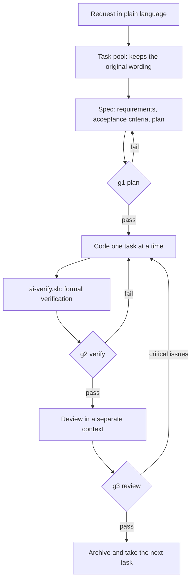
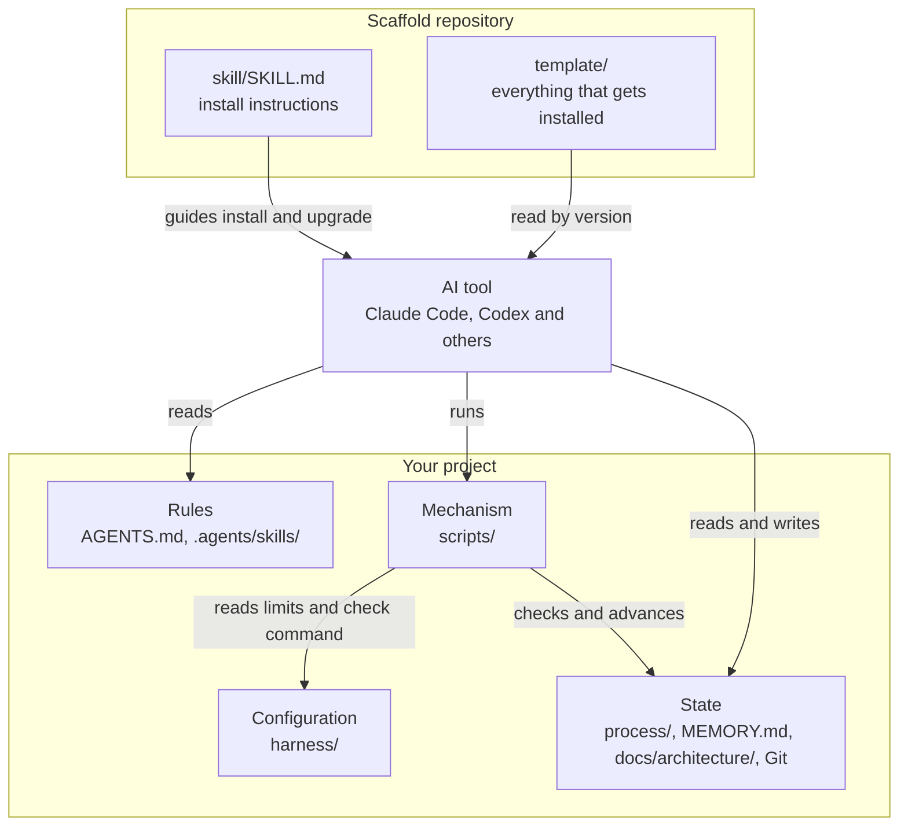

<div align="center">

# ai-harness

**A verifiable delivery process for AI coding tools that survives switching tools and sessions.**

[](https://github.com/Alan-IFT/ai-harness-scaffold/actions/workflows/selftest.yml)
[](https://github.com/Alan-IFT/ai-harness-scaffold/releases/latest)
[](LICENSE)
-lightgrey)

[简体中文](README.md) | English

</div>

ai-harness is a development process you install into a project: rule documents, Bash gate scripts and process templates. A task pool collects requests, three gates (plan, verify, review) control delivery, and files in Git carry the work from one tool or session to the next. It has no server and no runtime dependencies.

**The rules, templates and gate messages are all in Chinese.** There is no English version, so your AI tool will read and produce Chinese process documents unless you tell it otherwise. The gate scripts also match Chinese field names in those documents. This page is a summary; [README.md](README.md) has the full details, in Chinese.

## Getting started

Requirements:

- Windows with Git Bash. macOS and Linux are not supported.
- Git and access to GitHub.
- An AI tool that can read `AGENTS.md` and run bash. Tested with Claude Code and Codex.

In your project, send this to your AI tool. The same sentence covers new projects, existing projects and upgrades:

```
Make a full clone of https://github.com/Alan-IFT/ai-harness-scaffold.git in a temporary directory and follow its skill/SKILL.md to install the ai-harness scaffold into the current project, or upgrade it to the latest version if it is already installed.
```

There is no install command. The AI works out which case applies, installs the latest tag and checks the result. Projects installed from v2.1.3 onward can upgrade later with just "upgrade the scaffold to the latest version".

## How it works

You state requests in plain language and the AI runs the process. Each request becomes a Spec that passes three gates before it is archived:



- **g1 plan**: the original request, acceptance criteria and plan are filled in, and no open questions remain.
- **g2 verify**: all tasks are done and the configured check passed against the current code. Any code change afterwards invalidates the result.
- **g3 review**: a context that did not write the code reports zero critical issues. Requests that touch data, permissions, releases or architecture also need a person's decision.

To switch tools, have the new one run `bash scripts/ai-resume.sh owner`. It summarizes gate status, the current Spec's progress and uncommitted changes.

## Architecture

The scaffold does not keep running. The AI installs the template into your project, and every AI tool then reads the same rules and runs the same scripts:



## Before you use it

- The gates run locally. They catch mistakes but are not a security boundary.
- `ai-verify.sh` runs the `CUSTOM_CHECK` command from `harness/verify.conf`. Read that file before running the scripts on a project you don't trust.

## Feedback and license

Open an [Issue](https://github.com/Alan-IFT/ai-harness-scaffold/issues) for bugs and ideas. Discuss in an Issue before sending a pull request. Report security problems through [private vulnerability reporting](https://github.com/Alan-IFT/ai-harness-scaffold/security/advisories/new).

[MIT](LICENSE).
