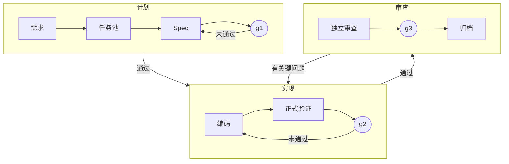
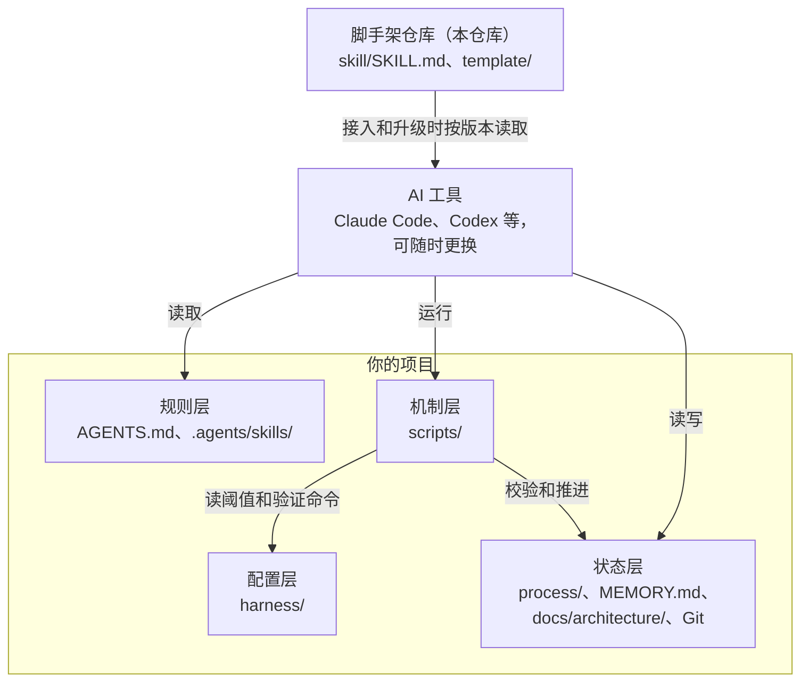

<div align="center">

# ai-harness

**让 AI 编程工具按可验证的流程交付，换工具、换会话也能接着做。**

[](https://github.com/Alan-IFT/ai-harness-scaffold/actions/workflows/selftest.yml)
[](https://github.com/Alan-IFT/ai-harness-scaffold/releases/latest)
[](LICENSE)
-lightgrey)

简体中文 | [English](README.en.md)

</div>

ai-harness 是一套装进项目里的 AI 开发规范，由规则文档、Bash 门禁脚本和流程模板组成。任务池收需求，三道门（计划 / 验证 / 审查）管交付，WIP 与 Git 管接力，`MEMORY.md` 与模块活文档积累经验。

它不绑定 AI 工具，也没有服务端和运行时依赖：所有状态都是项目里的文件。规范、模板和门禁提示都是中文。

## 目录

- [为什么需要它](#为什么需要它)
- [快速开始](#快速开始)
- [工作原理](#工作原理)
- [架构](#架构)
- [支持的 AI 工具](#支持的-ai-工具)
- [安全与局限](#安全与局限)
- [设计取舍](#设计取舍)
- [参与开发](#参与开发)
- [许可证](#许可证)

## 为什么需要它

用 AI 写代码时，这些问题反复出现。ai-harness 用文件和脚本把它们挡在流程里：

| 常见问题 | ai-harness 的做法 |
| :-- | :-- |
| 换工具或开新会话，进度和上下文就丢了 | 进度、已排除的方案和下一步写在 Spec 的 WIP 区，`ai-resume.sh` 一条命令生成接手快照 |
| AI 说「做完了」，其实没验证，或验证后又改了代码 | g2 要求验证命令真实跑过，且状态指纹与当前代码一致；代码一变，验证就失效 |
| 写代码的 AI 自己审自己 | g3 要求没参与实现的上下文写审查报告，关键问题清零才能通过 |
| 需求在转述中走样 | 任务池和 Spec 保存原话，编码前回读原话和验收标准 |
| 数据、权限、发布这类决定被 AI 代做 | 这类需求标记「需人决定：是」，g3 要有人的当次决定 |
| 规则文档越堆越长，AI 反而不看 | `AGENTS.md` 和 `MEMORY.md` 有行数上限，超限先删再加 |

## 快速开始

### 前置条件

- Windows 与 Git Bash（只支持 Windows，macOS 和 Linux 未适配）；AI 工具调到的 `bash` 是 WSL 时，见下文「安全与局限」
- Git，能访问 GitHub
- 一个能读 `AGENTS.md`、能跑 bash 的 AI 工具

### 接入

在你的项目里，把这句话发给 AI。新项目、老项目、升级都用这一句：

```
把 https://github.com/Alan-IFT/ai-harness-scaffold.git 完整克隆到临时目录，按其中的 skill/SKILL.md 给当前项目接入 ai-harness 脚手架；已接入的就升级到最新版。
```

没有安装命令。AI 会自己判断属于哪种情况，完成摸底、合并、验证命令、一个模块试点和体检，只把架构、权限、阈值这类需要你决定的事交回来。老项目已有的文件不会被覆盖，冲突的内容由 AI 合并或列给你决定。

- **以后升级**：从 v2.1.3 起接入的项目，直接说「把脚手架升级到最新版」就行。更早接入的项目先用上面那句升级一次。
- **降级或指定版本**：直接告诉 AI 版本号，如「把脚手架降级到 v2.1.1」。
- **不能访问 GitHub**：自己克隆一份（要完整克隆，ZIP 不行），把上面那句的地址换成本机路径。
- **版本**：接入和升级默认取最新 tag，没有 tag 时取 HEAD。`main` 可能包含未发布的改动，要用它就明确告诉 AI。

### 日常使用

装好后，你只需要用自然语言说需求，流程由 AI 走：

- **提需求**：直接说，AI 收录进任务池。有进行中的工作就排队，没有就开始。
- **换工具**：让新工具运行 `bash scripts/ai-resume.sh owner`，它会接着做。
- **做决定**：涉及数据、权限、发布或架构取舍的需求，AI 会把风险交给你当次决定。
- **设偏好**：回复语言、语气、详略这类习惯写进 `~/.ai-harness/PREFERENCES.md`，所有项目和 AI 工具共用；只对某个项目的写进该项目根的 `PREFERENCES.md`（不入库）。

## 工作原理

### 交付流程

每个需求对应一个 Spec，走完三道门后归档：



任务池保存需求原话，Spec 写需求、验收标准和方案。编码一次只做一个任务，由 `ai-verify.sh` 正式验证；审查由没写过这些代码的上下文完成。归档后领取下一项。

### 三道门

门由 `ai-gate.sh` 机械校验，只查磁盘上的客观信号；措辞和方案质量交给独立审查和人。

| 门 | 校验内容 |
| :-- | :-- |
| **g1 计划** | 原话、「需人决定」、「做什么」已填；验收标准无空单元格，每条都有任务对应；待确认问题清零；方案「思路」已填 |
| **g2 验证** | 任务全部勾选；`verification.md` 结果为 PASS；状态指纹与当前代码一致 |
| **g3 审查** | 验证仍有效；`review.md` 声明未参与实现、关键问题为 0、轮次不超上限、审查的是当前验证状态；「需人决定：是」时记录了人的通过决定和来源 |

**状态指纹**是对全仓 Git 索引、未暂存改动和未跟踪文件计算的 SHA-256，只排除流程记录目录 `process/`。验证后任何代码变化都会让 g2 和 g3 失效。

出现这些情况时 AI 要停下等人：同一 Spec 连续验证失败达到 `VERIFY_MAX_ATTEMPTS`，审查修复轮次超过 `CR_MAX_ROUNDS`，需要扩大范围或改变契约，或者要做删数据、强推、发布、改红线这类不可逆操作。

### 接力与经验积累

项目文件和 Git 是接力状态的唯一来源，不依赖任何工具的会话记忆：

- **接手**：`ai-resume.sh owner` 汇总门禁状态、活跃 Spec 的断点、任务池下一步和未提交的改动。
- **审查**：`ai-resume.sh review <feat> <base-ref>` 给审查者列出必读文件和 diff，不带实现者的解释。
- **积累**：设计决策和已知坑写进模块活文档，只写「为什么」；用户纠正和反复尝试才解决的问题写进 `MEMORY.md`。

## 架构

### 总体结构

脚手架本身不常驻运行。AI 按说明把模板装进项目，之后各个 AI 工具都读同一份规则、跑同一套脚本：



| 层 | 组成 | 职责 | 谁来改 |
| :-- | :-- | :-- | :-- |
| 规则层 | `AGENTS.md`、`.agents/skills/` | 告诉 AI 怎么接手、编码、验证和审查 | 升级时更新，项目可以合并自己的规则 |
| 机制层 | `scripts/` | 校验门禁、跑验证、管任务池、生成接手快照 | 升级时更新 |
| 配置层 | `harness/` | 阈值和项目的验证命令 | 阈值只由人改；验证命令接入时选定 |
| 状态层 | `process/`、`MEMORY.md`、`docs/architecture/`、Git | 需求、进度、验证结果和项目经验 | AI 日常读写，升级时不动 |

### 接入后的项目结构

```
your-project/
├── AGENTS.md                # 规则入口，各 AI 工具都读
├── CLAUDE.md                # 只有一行，导入 AGENTS.md
├── MEMORY.md                # 项目经验：踩过的坑、用户的纠正
├── PREFERENCES.md           # 本项目的个人偏好（不入库）
├── .agents/skills/          # 按阶段读的指南：new-spec、code-review、archive-spec、upgrade
├── .ai-harness/
│   ├── LICENSE.md           # 脚手架的许可声明
│   └── version              # 所装版本的提交号，升级时作基线
├── docs/architecture/
│   ├── 00-INDEX.md          # 模块索引
│   └── modules/             # 模块活文档：设计决策与已知坑
├── harness/
│   ├── redlines.conf        # 阈值，只由人改
│   └── verify.conf          # 项目的验证命令
├── process/
│   ├── task-pool/           # 没做完的需求原话，每个需求一个文件
│   └── specs/
│       ├── _templates/      # Spec 模板
│       ├── active/<feat>/   # 进行中：requirements、tasks、verification、review
│       └── archive/YYYY-MM/ # 已归档的 Spec，任务文件随 Spec 移到这里
└── scripts/                 # 门禁与流程脚本
```

### 脚本

平时由 AI 调用，你不需要记。都是 Bash，用 Git Bash 自带的工具运行。

| 脚本 | 作用 | 主要用法 |
| :-- | :-- | :-- |
| `ai-task-pool.sh` | 收录需求、排队、领取、归档 | `intake`、`add`、`list`、`next`、`start-next`、`archive` |
| `ai-new-spec.sh` | 从模板新建 Spec | `<feat>` |
| `ai-gate.sh` | 校验和推进三道门 | `status`、`check`、`pass`、`reset` |
| `ai-verify.sh` | 跑验证命令，写入结果和状态指纹 | `--spec <feat>` |
| `ai-state-id.sh` | 计算状态指纹 | 无参数 |
| `ai-resume.sh` | 生成接手或审查快照 | `owner [feat]`、`review <feat> <base-ref>` |
| `ai-check-bloat.sh` | 检查 `AGENTS.md` 和 `MEMORY.md` 的行数 | 无参数 |
| `ai-config.sh` | 读取和校验红线配置，供其他脚本加载 | 不直接运行 |
| `harness-selftest.sh` | 用坏样例和好样例检查脚本该拦的拦得住、该过的过得去 | 无参数 |

### 配置

每个项目以自己的 `harness/` 为准。

| 文件 | 键 | 作用 | 模板默认值 |
| :-- | :-- | :-- | :-- |
| `redlines.conf` | `AGENTS_MAX_LINES` | `AGENTS.md` 行数上限 | 120 |
| `redlines.conf` | `MEMORY_MAX_LINES` | `MEMORY.md` 行数上限 | 150 |
| `redlines.conf` | `VERIFY_MAX_ATTEMPTS` | 同一 Spec 连续验证失败上限 | 3 |
| `redlines.conf` | `CR_MAX_ROUNDS` | 审查修复轮次上限 | 4 |
| `verify.conf` | `CUSTOM_CHECK` | 正式验证运行的命令，如 `npm test`；不配置时 g2 过不去 | 空 |

## 支持的 AI 工具

- **实测过**：Claude Code、Codex。
- **理论兼容**：Cursor、DeepSeek 等能读 `AGENTS.md`、能跑 bash 的工具，未实测。

## 安全与局限

- **门禁不是安全边界**：门禁脚本在本地运行，防的是疏漏，防不住有意绕过。比如 `review.md` 里的「未参与实现」是声明，脚本无法核实。需要强制审批时，用代码托管平台的权限机制。
- **配置里的命令会被执行**：`ai-verify.sh` 用 `bash -c` 执行 `harness/verify.conf` 的 `CUSTOM_CHECK`。在别人的项目上运行前，先看这个文件。
- **同一台 Windows 上的 `bash` 不一定是同一个**：有的 AI 工具用 Git Bash，有的调到 WSL 里的 bash，取决于 PATH 里哪个在前。门禁脚本两边都能跑，但两边的 Git 配置各是各的，同一份代码算出的状态指纹可能不同，换工具接手后验证会显示过期，重跑即可。已知的两个原因：换行设置不同，所以别删 `.gitattributes` 里统一换行的那一行；只被 Windows 这边的全局忽略文件忽略的未跟踪文件，WSL 那边会计入指纹，要两边一致就把它们写进项目的 `.gitignore`。`CUSTOM_CHECK` 在调用它的那个环境里运行，依赖要两边都能用。WSL 里的 `~` 不是 Windows 用户目录，通用偏好以 `%USERPROFILE%\.ai-harness\PREFERENCES.md` 为准。本仓库的 CI 在 Git Bash 和 Linux 上各跑一遍自检，后者替 WSL 把关，不代表支持 Linux。
- **门不判断质量**：验证只说明你配置的那条命令通过了，所以它得是真能证明行为的检查；方案和代码好不好，靠独立审查和人。
- **只有中文**：规范、模板和门禁提示都是中文，脚本也按中文字段名校验文档。

## 设计取舍

- **少就是多**：早期的七道门有约 3500 行机制代码，真实缺陷却都由独立审查发现，格式检查只留下误报。现在只留三道门，会让脚手架变臃肿的功能、配置和文档直接删除，追溯交给 Git（见 [ADR-0003](docs/architecture/decisions/ADR-0003-three-gates-no-compat-code.md)）。
- **不写 CLI 与兼容代码**：接入、升级、降级都写成说明，由 AI 判断执行；特殊情况比命令行处理得好。
- **不覆盖、不猜测**：老项目已有的 `AGENTS.md` 等是团队约定，合并是判断题，不是复制题。
- **阈值只有一处**：每个项目以自己的 `harness/redlines.conf` 为准，只由人修改；缺键或值无效时脚本直接报错。
- **编码原则取自 Karpathy 准则**：`template/AGENTS.md` §3 的四条原则译自 [andrej-karpathy-skills](https://github.com/multica-ai/andrej-karpathy-skills)，来源与许可见 `template/.ai-harness/LICENSE.md`。

## 参与开发

本仓库也用这套流程开发自己。

```
template/          # 接入目标项目的全部内容（唯一真相源）
skill/SKILL.md     # 接入说明，由 AI 照着判断执行
scripts/           # 只转发到 template/scripts/，不复制逻辑
docs/architecture/ # 架构索引、模块活文档与 ADR
harness/           # 本仓库自己的阈值和验证命令
process/           # 本仓库自用的任务和 Spec 记录，不会装进你的项目
```

- **开发约定**：读 [AGENTS.md](AGENTS.md)。各模块的设计依据从 [架构索引](docs/architecture/00-INDEX.md) 进入。
- **自检**：改脚本后运行 `bash scripts/harness-selftest.sh`，CI 在 `windows-latest` 和 `ubuntu-latest` 上跑同一份自检。
- **问题和建议**：提 [Issue](https://github.com/Alan-IFT/ai-harness-scaffold/issues)。目前只收 Issue，Pull Request 个案处理，提交前请先开 Issue 讨论。
- **安全问题**：通过 [私密漏洞报告](https://github.com/Alan-IFT/ai-harness-scaffold/security/advisories/new) 提交，不要公开发 Issue。

## 许可证

[MIT](LICENSE)。接入时会把许可声明一起装到项目的 `.ai-harness/LICENSE.md`，它不决定你项目自身的许可证。
