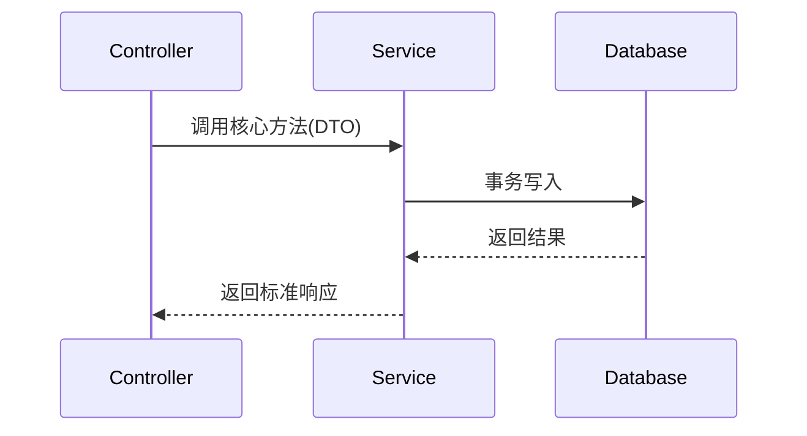

# 技术架构与接口设计 (Technical Design): {{FEATURE_NAME}}

- **关联需求**: `requirements.md`（G1 / G2 已通过）
- **关联活文档**: `@docs/architecture/modules/xxx.md`
- **设计者**: （模型 / 人）
- **状态**: Draft | Approved

## 1. 架构变更与数据流 (Architecture & Data Flow)
> 说明影响哪些模块 / 表 / 契约；用 Mermaid 描述核心调用链；写清数据由谁拥有。严禁写冗长散文。



## 2. 实现顺序、垂直切片与检查点
> 铁律：按依赖图**自底向上**推进（存储 → 协议 / 契约 → 业务逻辑 → 调用方 / 接口）。
> 每一步都必须是能独立运行和验证的垂直切片，而不是"一次性写完再跑"。

1. 步骤 1：改哪个文件、做完后处于什么可运行状态、验证命令
2. 步骤 2：…
3. 步骤 3：…

- **检查点**（每 2~3 步插一个，写清检查什么、谁来看）：
  - 检查点 1（第 2 步后）：
- **拆分自查**（任一命中就先拆再写）：
  - 单步 >5 个文件？跨 2 个子系统？任务标题里出现「并且 / 同时」？

## 3. 接口契约与数据结构变更 (Contracts & Schema)

### 3.1 数据库 Schema 变更（如有）
- 新增 / 修改表字段及索引：

### 3.2 核心接口 / 类型定义（只列签名，不写实现）
```typescript
// 入参、出参、错误类型
```

### 3.3 契约兼容性
- 旧调用方 / 旧数据 / 旧客户端怎么办；是否需要 expand → migrate → contract 三步走。

## 4. 影响面与涉及文件清单 (Blast Radius & File Manifest)
> 编码阶段**只允许**动下面列出的文件；超出范围必须先停下更新本节并重新过 G3。

- **新建文件**：
  - `path/to/new-file.ts`：职责说明

- **修改文件**：
  - `path/to/existing-file.ts`：修改点说明

- **只读依赖契约**：
  - `path/to/other-module/index.ts`

## 5. 对抗自审（默认作者会过度自信）
> 逐条回答，答不出说明方案还不完整。这一节的结论会被 G3 检查是否填了实质内容。

1. 这个方案最可能错在哪？
2. 有没有未言明的假设（数据量、并发、权限、时序、外部依赖可用性）？
3. 哪些边界 / 失败路径没有处理？
4. 能不能更简单（少一个抽象层 / 依赖 / 配置 / 表）？
5. 上线后出问题怎么回滚？

- **自审结论**：

## 6. 待确认问题（产品 / 技术，清零或明确"不阻塞"后才能开工）
- [ ] Q1：

## 7. 风险与回滚
- **风险**：
- **回滚方式**：
