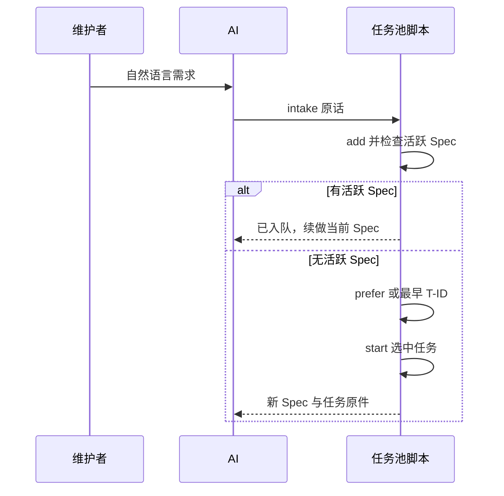

# 技术设计：feat-auto-task-routing

- 追溯版本：1
- 状态：Draft

## 0. 模块关联
- 主模块：模板机制 → `docs/architecture/modules/template-mechanism.md`
- 涉及模块：项目指南 → `docs/architecture/modules/guidance.md`；本仓库自用 → `docs/architecture/modules/self-hosting.md`
- 契约入口：`template/scripts/ai-task-pool.sh`、`template/AGENTS.md`
- 人工前置决策：决策人=维护者；来源=本次会话答复「命令不方便，直接给AI说需求会方便很多」；取舍=维护者只用自然语言，AI 内部调用任务池命令实现持久分流和人工指定；结论=按自然语言入口实施。

## 1. 架构变更与数据流
AI 读项目规则后，将独立新需求交给 `ai-task-pool.sh intake <原话>`；命令收录任务后调用 `start-next`。后者在任务池锁内一次完成“检查活跃 Spec → 选择指定或最早待办 → 创建 Spec”，避免选取与启动之间的人工指定竞态。归档也由 `archive <feat>` 持同一把锁移动 active Spec；归档成功后 AI 调用 `start-next`，使先看到活跃 Spec 的并发 intake 不会留下无人领取的待办。锁冲突明确失败，调用方重试，不伪报完成。有活跃 Spec 时返回续做提示。任务补充调用 `update`，活跃 Spec 同步修改并回退门。待办默认按 ID 排序；旧优先级仅作信息字段。人工指定由 `prefer <T-ID>` 写入 `docs/task-pool/NEXT`；`next` 与 `start-next` 读取它，仅成功启动该指定任务时清除。任务原话由任务文件拥有，状态仍由 Spec 位置派生。

### 1.1 需求覆盖矩阵
| 来源 ID | 原文锚点 / 语义细则 | 设计落点 | 验证 |
| :-- | :-- | :-- | :-- |
| REQ-01 | requirements.md §2.3 若有则入池 | §1 intake | AC-01 |
| REQ-02 | requirements.md §2.3 空池开始 | §1 intake/start | AC-01 |
| REQ-03 | requirements.md §2.3 先后顺序 | §1 pending_rows | AC-02 |
| REQ-04 | requirements.md §2.3 人工指定 | §1 prefer/NEXT | AC-03 |
| REQ-05 | requirements.md §2 补充 | §1 指南/update | AC-04 |
| ERR-01 | requirements.md §2 无效指定 | §3 prefer 校验 | AC-03 |
| ERR-02 | requirements.md §2 自动启动失败 | §3 intake 失败语义 | AC-01 |
| AC-01 | requirements.md §3 | §2 自检 | AC-01 |
| AC-02 | requirements.md §3 | §2 自检 | AC-02 |
| AC-03 | requirements.md §3 | §2 自检 | AC-03 |
| AC-04 | requirements.md §3 | §2 文档检查 | AC-04 |

## 2. 实现顺序、切片与检查点
1. 改 `pending_rows` 为 ID 顺序，加入 `prefer` 和选择逻辑；自检验证默认 FIFO、一次性指定、非法目标。
2. 加 `intake` 与同锁 `start-next`，组合现有 add/选择/启动路径，失败时保留已收录任务；自检验证空池、有活跃 Spec、已有待办、人工指定竞态语义与失败路径。检查点：不存在双活跃 Spec，手工启动其他任务不丢指定。
3. 更新模板和本仓库的 AGENTS、需求/归档技能、README、架构描述；归档必须与 start-next 使用同一锁，归档后继续领取；核对 CLI 文档与安装器交付路径。检查点：自然语言入口不要求维护者手工命令。
- 边界样本：P0 晚于 P2、暂缓或已关联的指定目标、活跃 Spec 期间指定下一项、start 模板缺失、收录后并发出现新 Spec、活跃 Spec 在 intake 中途归档、归档时锁冲突不得移动目录、人工 prefer 在选择与启动间改变、空池与非空池 intake。

## 3. 接口契约与数据结构
- `ai-task-pool.sh intake <原话>`：成功先收录，再调用同锁路由 `start-next`；有活跃 Spec 时输出续做，否则自动启动所选待办。若收录成功但启动失败，返回非零并输出已收录 ID；调用方查看 `next` 恢复，不重发需求。
- `ai-task-pool.sh prefer <T-ID>`：只接受未关联、状态为待办的任务；成功写 `docs/task-pool/NEXT`。后一次指定覆盖前一次。
- `ai-task-pool.sh next`：活跃 Spec 优先；无活跃时 NEXT 有效则选之，否则按 T-ID 升序。NEXT 失效时明确报错，避免默默跳过人的选择。
- `ai-task-pool.sh start-next`：在单次任务池锁内检查活跃 Spec、选待办并启动，避免选择后人工指定变化。`ai-task-pool.sh start <T-ID> <feat-id>`：成功启动被指定任务才删除 NEXT；启动其他任务时保留 NEXT；失败也保留 NEXT。
- `ai-task-pool.sh archive <feat-id>`：在同一任务池锁内校验 source/destination 实际绝对路径均在项目 `docs/specs/` 下，拒绝符号链接、缺失源和已有目标后移动 Spec。调用方随后执行 G7、提交，再在有待办时调用 `start-next`；锁冲突失败并保留 active，不视为归档成功。
- 保留 `add --priority` 和旧任务文件字段，无迁移；优先级不参与选择。生成的自动 Spec ID 为 `feat-t-NNNNNN`，稳定且不依赖中文转写。

## 4. 影响面与文件清单
- 新建文件：`docs/task-pool/NEXT` 仅在运行 prefer 时创建；本次仓库不预置。
- 修改文件：
  - `template/scripts/ai-task-pool.sh`：选择、指定与 intake。
  - `template/scripts/harness-selftest.sh`：任务池行为回归。
  - `template/AGENTS.md`：自然语言入口。
  - `template/.agents/skills/new-spec.md`：需求录入指南。
  - `template/.agents/skills/archive-spec.md`：同锁归档和归档后领取。
  - `template/docs/task-pool/README.md`：队列说明。
  - `template/docs/INTAKE.md`：新需求入口引用。
  - `AGENTS.md`：本仓库自用入口。
  - `docs/INTAKE.md`：旧入口指向自然语言任务池。
  - `docs/task-pool/README.md`：本仓库队列说明。
  - `README.md`：用户文档。
  - `docs/architecture/modules/template-mechanism.md`：任务池契约。
  - `docs/architecture/modules/guidance.md`：指南契约。
  - `docs/architecture/modules/self-hosting.md`：自用状态。
- 只读依赖契约：`template/scripts/ai-new-spec.sh`、`template/scripts/ai-resume.sh`、`bin/ai-harness`、`harness/verify.conf`。
- 间接消费者 / 副作用：安装器分发 template 目录，根目录 scripts 仍只转发；owner 接手只读 next；旧优先级任务保留但调度含义改变。
- 检索依据：`rg -n '任务池|优先级|P0|ai-task-pool' README.md template docs/architecture bin tests`。

## 5. 对抗自审
1. 最可能错在 intake 失败后重复收录；明确输出 ID 并指示用 next 恢复。
2. 假设一个项目仅允许一个活跃 Spec，与现有 start 约束一致。
3. 指定目标失效须报错；自动启动失败不得丢已收录原话；并发 start 要由现有锁与活跃检查拒绝。
4. 使用现有脚本与单个 NEXT 文件，无新服务。
5. 回滚脚本/指南，普通任务文件和 NEXT 均可人工读取。
- 自审结论：先验证状态分支，再更新 AI 入口。

## 6. 待确认问题
无阻塞问题；维护者已明确自然语言入口，内部持久实现由 Agent 按 §1~3 完成。

## 7. 风险与回滚
- 风险：旧项目使用 P0 调度的习惯会变化；文档和输出明确优先级仅供展示，人工可 prefer。
- 回滚方式：回退脚本与指南，任务内容及稳定 ID 仍可使用。
