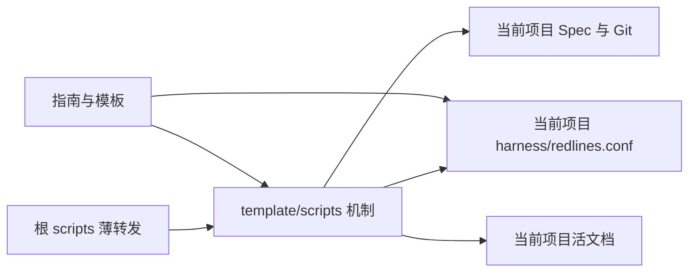

# 技术架构与接口设计 (Technical Design): feat-single-source-of-truth

- **关联需求**: `requirements.md`（G1/G2 已通过）
- **设计者**: Codex Agent；所有权原则与薄转发由 维护者 决定
- **状态**: Approved for implementation

## 0. 模块关联
- 主模块：模板机制 → `docs/architecture/modules/template-mechanism.md`
- 涉及模块：项目指南 → `docs/architecture/modules/guidance.md`；本仓库自用状态 → `docs/architecture/modules/self-hosting.md`
- 契约入口（只读）：`template/scripts/ai-gate.sh`、`template/scripts/ai-verify.sh`、`template/harness/redlines.conf`、`scripts/ai-gate.sh`
- 新增模块：无；以上模块均已在 `docs/architecture/00-INDEX.md` 登记。
- 人工前置决策：决策人 维护者；取舍为跨 IDE 使用项目内文档、根目录薄转发；结论是「一个事实只在一个地方」，且先完成前两项 Spec。本设计据此拆成模板机制源码、每项目配置、项目状态与引用说明。

## 1. 架构变更与所有权
| 事实 | 唯一所有者 | 其他位置的表达 |
| :-- | :-- | :-- |
| 脚本执行规则 | `template/scripts/` | 根 `scripts/` 薄转发；文档写命令入口 |
| 项目阈值数值 | 该项目 `harness/redlines.conf` | 脚本只读键并验证；指南和模板只引用键 |
| 新项目初始阈值 | `template/harness/redlines.conf` | 安装时复制一次，之后成为目标项目自己的配置 |
| 当前任务状态 | 该项目 `docs/specs/active/<feat>/` 与 Git | `docs/INTAKE.md` 只留原话、决定与链接；`MEMORY.md` 只留可复用知识 |
| 已归档交付事实 | 该项目 `docs/specs/archive/` | `docs/metrics.md` 只记可比度量，不复写完整验收 |

## 2. 实现顺序、垂直切片与检查点
1. 配置切片：在 `template/scripts/` 建统一的本地配置加载器，让 gate、verify、bloat、knowledge 不再内置重复阈值；现有完整配置继续运行。检查缺失/错误配置与自检正反例。
2. 指南切片：将 `template/AGENTS.md`、`template/MEMORY.md`、相关 skill、Spec 模板和安装 skill 的阈值数字改成配置键引用；调整旧项目补齐说明。检查检索结果与门禁模板兼容。
3. 状态切片：修正验证摘要“提交即过期”的文案、INTAKE 归档链接；补上所有权表与回归断言。根入口和目标项目安装样本都跑完整检查。
- **检查点**：每个切片后运行 Bash 语法与自检；第 3 步后核对根脚本仍是薄转发且目标安装脚本可独立执行。
- **拆分自查**：跨模板机制、项目指南和自用状态三个模块，分三个切片；每次只改本切片对应的路径。

## 3. 接口契约与兼容性
- 无数据库 Schema 或公共网络 API 变化。
- 新内部接口：`source scripts/ai-config.sh` 后调用 `ai_config_load <config-path> <required-numeric-key...>`；成功时在当前 shell 暴露配置键，失败返回非零并给出缺失或非法键名。
- 正常完整配置保持同样阈值与门禁行为；缺失或非法配置由静默默认改为显式失败。安装/retrofit 指引说明如何补齐，不能覆盖目标项目已有配置。
- `ai-state-id.sh` 的索引内容语义不变；仅修复生成摘要与门禁报错中的过时描述。

## 4. 影响面与涉及文件清单
- **新建文件**：
  - `template/scripts/ai-config.sh`：配置读取和必需键校验的唯一实现。
- **修改文件**：
  - `template/scripts/ai-gate.sh`、`template/scripts/ai-verify.sh`、`template/scripts/ai-check-bloat.sh`、`template/scripts/ai-knowledge.sh`：移除默认数值，接入加载器，修正文案。
  - `template/scripts/harness-selftest.sh`：配置修改、缺失/非法配置、暂存到提交及安装样本回归断言。
  - `template/AGENTS.md`、`template/MEMORY.md`、`template/.agents/skills/new-spec.md`、`template/.agents/skills/gc-memory.md`、`template/.agents/skills/code-review.md`：仅引用配置键。
  - `template/docs/specs/_templates/requirements.md`、`template/docs/specs/_templates/tasks.md`：移除可变阈值数值。
  - `skill/SKILL.md`、`README.md`：老项目接入与单一所有者说明。
  - `docs/INTAKE.md`、`docs/architecture/modules/template-mechanism.md`、`docs/architecture/modules/guidance.md`、`docs/architecture/modules/self-hosting.md`：更新链接及活态设计。
- **只读依赖契约**：
  - `template/harness/redlines.conf`、`harness/redlines.conf`：阈值不改，核对已列全必要键。
  - `bin/ai-harness`：核对复制 `template/scripts/*` 的安装行为。
  - `scripts/*.sh`：核对仍仅薄转发。
- 间接消费者 / 副作用：新旧项目安装和 retrofit 复制脚本；CI 调用自检；G1/G5 文档与门禁解析；知识卡 TTL 显示；根仓库自用验证。上述均在本切片的检查范围。
- 检索依据：`rg -n 'AGENTS_MAX_LINES|MEMORY_MAX_LINES|ACTIVE_SPECS_LIMIT|VERIFY_MAX_SECONDS|VERIFY_MAX_ATTEMPTS|CR_MAX_ROUNDS|FEASIBILITY_MIN|KNOWLEDGE_TTL_DAYS|提交后|baseline' template skill README.md bin scripts docs/architecture`；按命中逐项复核。

## 5. 对抗自审
1. 最可能错：加载器在被 source 的 shell 中未能传播失败，或部分脚本仍保留默认值；用负例直接断言退出码与提示。
2. 未言明假设：目标项目安装了完整 `template/scripts/*` 与 `harness/redlines.conf`；用安装样本验证。
3. 失败路径：老项目配置缺键、数字非正、根与模板配置不同、配置漂移、无 Git 项目；分别检验或保留现有诊断。
4. 更简单方案：只做一个 Bash 配置加载器，不加新状态服务或文档生成层。
5. 回滚：Git revert 本 Spec 变更；项目阈值数值未改，旧项目可补齐配置后重试。
- **自审结论**：先确保配置是唯一生效值，再删文档副本；明确测试夹具中的数字仅为反例数据，不是配置所有者。

## 6. 待确认问题
- [x] Q1：跨 IDE 是否使用宿主记忆？结论：不使用；项目内文档与 Git 是交接依据。
- [x] Q2：根目录是否复制机制？结论：不复制，薄转发。
- [x] Q3：是否变更红线数值？结论：本 Spec 不调整阈值数值。

## 7. 风险与回滚
- **风险**：不完整旧项目的脚本调用从默认继续改为报错；通过明确键名与迁移说明减轻。
- **回滚方式**：撤销本 Spec 提交；不改历史 Spec 和项目配置值。
