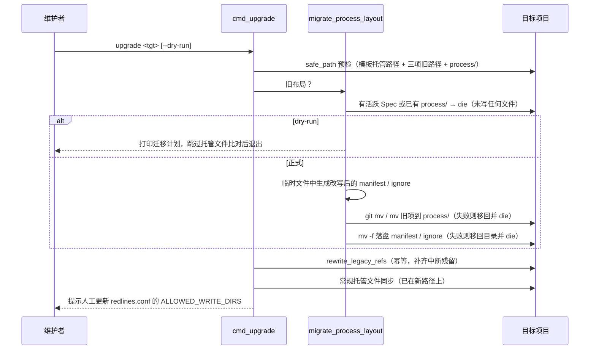

# 技术架构与接口设计 (Technical Design): feat-t-000033

- **关联需求**: `requirements.md`（G1 / G2 已通过）
- **设计者**: Claude Code（Opus 5.5）
- **状态**: Approved
- 追溯版本：1

## 0. 模块关联

- 主模块：模板机制 → `docs/architecture/modules/template-mechanism.md`
- 涉及模块：CLI → `docs/architecture/modules/cli.md`；项目指南 → `docs/architecture/modules/guidance.md`；本仓库自用状态 → `docs/architecture/modules/self-hosting.md`
- 契约入口（只读）：`docs/architecture/00-INDEX.md`
- 新增模块：无
- 人工前置决策：决策人：本会话维护者；来源：2026-10-24 对四个问题的选择——回滚「不做反向命令，2.0.0」、下游红线「不改，只输出提示」、迁移方式「能 git mv 就 git mv」、设计审查「本会话 subagent」；取舍：不提供反向迁移命令，回滚写进指南（旧版 CLI + 手动 `git mv` 回 `docs/`）；`VERSION` 升到 `2.0.0`，R1 与 R2 同版生效；upgrade 不改下游 `harness/redlines.conf`，结束时提示人工把 `ALLOWED_WRITE_DIRS` 中的 `docs/specs/active/` 改为 `process/specs/active/` 并重记基线；Git 已跟踪路径用 `git mv`，否则用 `mv`；结论：同意。

## 1. 架构变更与数据流

流程记录的根从 `docs/` 下三处收拢为顶层 `process/`，指纹只排除这一个根；upgrade 在常规文件同步之前完成一次性迁移。

| 旧路径 | 新路径 |
| :-- | :-- |
| `docs/specs/`（含 `_templates/`、`active/`、`archive/`） | `process/specs/` |
| `docs/task-pool/` | `process/task-pool/` |
| `docs/metrics.md` | `process/metrics.md` |

- **模板机制**（`template/scripts/`）：
  - 路径常量：`ai-gate.sh` 的 `SPEC_ROOT`、`ai-task-pool.sh` 的 `POOL` 及 Spec 路径、`ai-new-spec.sh`、`ai-resume.sh`、`ai-verify.sh`、`ai-check-bloat.sh` 改用 `process/...`。
  - `ai-task-pool.sh` 归档时的父目录符号链接检查（`for path in docs docs/specs ...`）改为 `process process/specs ...`。
  - `ai-state-id.sh`：删除 `manifest` / `scope_confirmed` / `valid_path` / `in_list` / `spec_dir` / `load_scope` / `claimed_elsewhere` 与 scoped 分支。`--spec <x>` 仍解析但不使用。只剩全仓模式：`git ls-files --stage` 与 `git diff --binary` 用 pathspec `':(exclude)process/**'`，未跟踪文件跳过 `process/*`。预计约 40 行。
  - `ai-verify.sh`：正式目标拒绝 `process/*`（替换原三项 case），拒绝文案改为「流程记录目录 process/」。
  - 旧布局判据（守卫与 CLI 共用同一定义，见 §3.2）：只认 harness 自己创建的标记，即 `docs/specs/active`、`docs/specs/archive`、`docs/specs/_templates` 任一目录存在，或 `docs/task-pool/README.md` 存在。项目自有的 `docs/specs/*.md` 规格文档、单独的 `docs/metrics.md` 都不算旧布局。
  - 旧布局守卫：`ai-config.sh` 新增 `ai_require_process_layout`。
    - 有旧标记、无 `process/`：向 stderr 输出「检测到旧布局，请运行 ai-harness upgrade 迁移到 process/」，返回 1。
    - 有旧标记、也有 `process/`（并存）：输出人工处置步骤——确认 `process/` 内容后，手动把旧目录 `git mv` 合并进 `process/`，或删除其中之一；返回 1。
    - 调用位置：`ai-gate.sh`、`ai-task-pool.sh`、`ai-new-spec.sh`、`ai-verify.sh`、`ai-resume.sh` 的入口，早于任何路径使用。`ai-verify.sh` 原本在第 75 行才 source `ai-config.sh`，要移到参数解析之前；`ai-task-pool.sh`、`ai-new-spec.sh`、`ai-resume.sh` 改为 source。
  - `ai-state-id.sh --spec` 的调用方（`ai-gate.sh:325`、`ai-verify.sh:229`、`ai-resume.sh:85,138`）都不需要改，参数照样传入、被忽略。
  - 模板文件：`template/docs/specs/` → `template/process/specs/`，`template/docs/task-pool/` → `template/process/task-pool/`，`template/docs/metrics.md` → `template/process/metrics.md`（均用 `git mv`）。`template/docs/INTAKE.md`、架构与 roadmap 不动。
  - `template/harness/redlines.conf` 的 `ALLOWED_WRITE_DIRS` 改为 `process/specs/active/`（只影响新安装）。ignore 模板中的 `docs/specs/...` 行改为 `process/specs/...`。
  - `ALLOWED_WRITE_DIRS` 当前没有任何脚本读取（`grep -rn ALLOWED_WRITE_DIRS` 只命中两份 conf），所以根目录红线不改、下游红线只提示，都不影响门禁行为。
  - 设计模板 §4：删除 scoped 指纹说明与「指纹范围确认」行，改为一句「状态指纹全仓计算，只排除 `process/`」。
- **CLI**（`bin/ai-harness`）：
  - `managed_file` 改为 `process/specs/_templates/*.md|process/task-pool/README.md`；`make_skeleton_dirs` 与 `rewrite_allowed_dirs` 改用 `process/specs/...`；`VERSION="2.0.0"`。
  - 新增 `migrate_process_layout <tgt>`，在 `cmd_upgrade` 中的位置：全部 `safe_path` 预检之后、第一次写入（`mktemp` 临时 manifest）之前。
  - 新增 `rewrite_legacy_refs <tgt>`：把 manifest 第 3 列与 ignore 文件 managed block 中的旧前缀改成新前缀。它是幂等的，每次正式 upgrade 都执行，不依赖 `legacy_layout`。所以即使上次在「目录已移、改写未完成」时中断，再跑一次 upgrade 也能补齐，不会让模板失去基线而误报冲突。
  - 迁移的原子性：先用临时文件生成改写后的 manifest 与 ignore 内容；再移动目录；最后用 `mv -f` 落盘。任一步失败，就把已移动的目录移回原处、`rmdir` 空的 `process/`，然后 die。
  - 旧布局 + `--dry-run`：只打印迁移计划（将移动的条目、拒绝条件检查结果、将改写的 manifest 行数与 ignore 文件），然后跳过托管文件比对，提示「迁移后再 dry-run 查看文件差异」。不引入路径映射。
  - `say` 提示文案（`bin/ai-harness:388`「移入 docs/specs/archive/」）改为 `process/specs/archive/`。
- **自检**（`harness-selftest.sh`）：夹具路径机械替换为 `process/...`；删除 scoped 指纹用例（约 626~690 行），换成新指纹用例与旧布局守卫用例。
- **本仓库**：`git mv docs/specs process/specs`、`git mv docs/task-pool process/task-pool`、`git mv docs/metrics.md process/metrics.md`。根目录 `.gitignore`、`AGENTS.md`、`MEMORY.md`、`scripts/ai-new-spec.sh`（模板目录改为 `template/process/specs/_templates`）、`docs/architecture/00-INDEX.md`、模块活文档同步。根目录转发脚本直接执行 `template/scripts/`，所以模板脚本改路径与本仓库迁移必须在同一步提交，否则门禁会被旧布局守卫拦住。



### 1.1 需求覆盖矩阵（②③必填）
| 来源 ID | 原文锚点 / 语义细则 | 设计落点 | 验证 |
| :-- | :-- | :-- | :-- |
| REQ-01 | 脚本读写 Spec、任务池、度量用 `process/...` | §1 模板机制路径常量；§2 步骤 2 | AC-01、AC-05 |
| REQ-02 | 只全仓模式，排除 `process/**`，`--spec` 接受但不改变结果 | §1 `ai-state-id.sh`；§2 步骤 1 | AC-02 |
| REQ-03 | 正式验证目标在 `process/` 下即拒绝 | §1 `ai-verify.sh`；§2 步骤 2 | AC-02、AC-06 |
| REQ-04 | 旧布局 + 无活跃 Spec + 无 `process/` → 迁移、同步 manifest 与 ignore，再常规升级 | §3.2 `migrate_process_layout`；§2 步骤 3 | AC-03 |
| REQ-05 | 本仓库已迁移，`VERSION` 升主版本；§2.3「与 R1 同一版本发布，下游只升级一次」 | §1 本仓库；§2 步骤 2、3 | AC-05 |
| ERR-01 | 活跃 Spec 或已有 `process/` → 拒绝且不写任何文件；§2.3「拒绝必须发生在任何写入之前」。细则：「`active/` 下有目录」解释为有非隐藏子目录或指向目录的符号链接；`ai-new-spec.sh` 遗留的 `.feat-x.tmp.*` 形式的 隐藏临时目录不算活跃 Spec，随目录迁移。原因是临时目录不是 Spec，若计入会永久阻断升级 | §3.2 拒绝条件放在首次写入之前 | AC-03 |
| ERR-02 | 新版脚本遇旧路径报错并提示 upgrade | §1 `ai_require_process_layout` | AC-04 |
| AC-01 | 旧路径只在 CLI 迁移逻辑中出现 | §4 修改清单 | `grep` |
| AC-02 | 指纹简化与三条指纹断言 | §2 步骤 1 | 自检 |
| AC-03 | 迁移回归五个用例 | §2 步骤 3 | `tests/cli-upgrade.sh` |
| AC-04 | 旧布局守卫 | §2 步骤 2 | 自检 |
| AC-05 | 本仓库迁移与 2.0.0 | §2 步骤 2、3 | 命令输出 |
| AC-06 | 回归与审查 | §2 步骤 5 | `verification.md`、`review.md` |

## 2. 实现顺序、垂直切片与检查点

1. 步骤 1（指纹简化，仍用旧路径）：重写 `template/scripts/ai-state-id.sh` 为全仓模式（排除项暂为原三项）。删除自检中的 scoped 用例，新增「`--spec one` 与不带参数结果相同」的断言。完成后脚本可运行，路径尚未改。验证：`bash scripts/harness-selftest.sh`。
2. 步骤 2（路径迁移 + 本仓库自迁移，一次提交）：
   - 前置：工作区不能有已删除的已跟踪文件，否则 `git mv` 目录会失败。当前 `docs/task-pool/NEXT` 是 `start-next` 留下的删除，在 G3 时连同 Spec 文件一起提交。
   - `git mv` 模板三项；改模板脚本路径常量；加 `ai_require_process_layout` 并在五个脚本入口调用；`ai-check-bloat.sh` 的告警文案同步改。
   - `ai-state-id.sh` 排除项改为 `process/**`；`ai-verify.sh` 拒绝 `process/*`。
   - 自检夹具机械替换为 `process/...`；新增 `process/` 改动不改指纹、`process-x/` 改动会改指纹、旧布局守卫（`ai-gate.sh status` 与 `ai-task-pool.sh next` 非零退出且输出含 `upgrade`）。
   - `git mv` 本仓库三项；同步根目录 `.gitignore`、`scripts/ai-new-spec.sh`、`AGENTS.md`、`MEMORY.md`、`docs/architecture/00-INDEX.md`。
   - 验证：自检，`bash scripts/ai-gate.sh status feat-t-000033`，`bash scripts/ai-task-pool.sh list`。
3. 步骤 3（CLI 迁移）：
   - `bin/ai-harness` 加 `legacy_layout`、`migrate_process_layout`、`rewrite_legacy_refs`；`managed_file`、骨架目录、`rewrite_allowed_dirs`、第 388 行提示、`VERSION=2.0.0` 同步。
   - `tests/cli-upgrade.sh` 改版本断言，新增 AC-03 的五个用例，再补三个：中断后重跑可自愈；`docs/specs` 下有项目自有文件时只迁 harness 子目录；retrofit 到自带 `docs/specs/*.md` 的项目后门禁不被守卫拦住。
   - 验证：`bash -n bin/ai-harness`、`bash tests/cli-upgrade.sh`、`retrofit --dry-run` 冒烟。
4. 步骤 4（指南与文档）：`template/AGENTS.md`、`template/.agents/skills/{archive-spec,retrofit-legacy,code-review,new-spec}.md`、设计模板 §4、`template/docs/architecture/00-INDEX.md`、`template/docs/INTAKE.md`、`template/docs/roadmap/ROADMAP.md`、ignore 模板、`README.md`、`skill/SKILL.md`（如有引用）、模块活文档、ADR-0002 R2 行状态。`retrofit-legacy.md` 写明迁移行为、拒绝条件、redlines 人工更新与回滚步骤。验证：AC-01 的 `grep`。
5. 步骤 5（正式验证）：`bash scripts/ai-verify.sh --spec feat-t-000033 template/scripts/ai-state-id.sh`，写 `verification.md`，过 G4 后交给独立 G5。

- **检查点**：
  - 检查点 1（第 2 步后）：Agent 自查。自检全过；本仓库门禁 `status` 显示本 Spec 位于 `process/specs/active/`；`docs/specs`、`docs/task-pool`、`docs/metrics.md` 已不存在。
  - 检查点 2（第 3 步后）：Agent 自查。`tests/cli-upgrade.sh` 全过，人工看一遍迁移输出文案。
- **拆分自查**：步骤 2 超过 5 个文件，且跨模板机制与本仓库两个子系统。原因是根目录转发脚本直接执行模板脚本，两者拆开提交会让中间状态被旧布局守卫拦住。以机械替换为主，提交前先跑自检兜底。其余步骤都在单一子系统内。
- 边界样本：迁移与指纹的非默认路径，逐条如下：
  - 只有部分旧项（例如有 `docs/specs/`，没有 `docs/metrics.md`）：只迁存在的项，不创建缺失项。
  - `docs/specs/` 下还有项目自有文件（如 `docs/specs/api.md`）：只迁 `_templates`、`active`、`archive` 三个子目录到 `process/specs/`；自有文件留在原处，`docs/specs/` 不删。迁移后旧标记消失，守卫不再报错。
  - 项目只有自有 `docs/specs/*.md`，没有 harness 标记（retrofit 新装）：不算旧布局，守卫放行，upgrade 不迁移。
  - `docs/specs/active/` 下只有 `.feat.tmp.XXXX` 隐藏临时目录：不算活跃 Spec，随目录迁移。
  - 有一个活跃 Spec 目录，或指向目录的符号链接：拒绝，快照不变（ERR-01）。
  - 已有 `process/`，无论是否为空：拒绝，快照不变；报错给出人工处置步骤。
  - 非 Git 项目、目标在父仓库的子目录（用 `git -C "$tgt"`）、或某项未跟踪（`git ls-files --error-unmatch` 判断）：未跟踪的项用 `mv`。
  - `git mv` 失败（例如索引锁）：把已移动的项移回原处，`rmdir` 空的 `process/`，然后 die；manifest 与 ignore 尚未落盘。
  - 目录已移动、manifest 或 ignore 落盘失败：同样移回目录并 die。若进程在中途被杀，下次 upgrade 的 `rewrite_legacy_refs` 会补齐改写。
  - 旧布局 + `--dry-run`：只打印迁移计划，不写任何文件，跳过托管文件比对。
  - 迁移后再次 upgrade：不再触发迁移，`rewrite_legacy_refs` 无改动，0 冲突。
  - 旧路径是符号链接，或 `process` 是符号链接或普通文件：`safe_path` 预检拒绝。
  - manifest 缺失（很旧的安装）：照常迁移，跳过 manifest 改写。
  - ignore 文件：只改 `MARK_BEGIN` 与 `MARK_END` 之间的行，用户自己的行不动；用临时文件加 `mv` 替换（不用 `sed -i`），保留 CRLF；覆盖 `.gitignore`、`.cursorignore`、`.claudeignore`。
  - 指纹：`process/` 下新增未跟踪文件不变；`process-x/a` 会变；`processes.md` 会变；`--spec 任意值` 与无参数相同。

## 3. 接口契约与数据结构变更 (Contracts & Schema)

### 3.1 数据库 Schema 变更（如有）
- 无数据库。`.ai-harness/manifest.tsv` 三列格式不变，迁移时只把第 3 列的前缀 `docs/specs/` 改为 `process/specs/`、`docs/task-pool/` 改为 `process/task-pool/`，哈希列原样保留。

### 3.2 核心接口 / 类型定义（只列签名，不写实现）
```bash
# template/scripts/ai-config.sh
ai_require_process_layout()   # 无参数；cwd 为项目根。旧标记存在 → stderr 提示（无 process/ 时提示 upgrade，并存时给人工步骤），return 1；否则 return 0
  # 旧标记：-d docs/specs/active || -d docs/specs/archive || -d docs/specs/_templates || -f docs/task-pool/README.md

# template/scripts/ai-state-id.sh
ai-state-id.sh [--spec <ignored>] <target>   # stdout：指纹；全仓排除 process/**

# bin/ai-harness
legacy_layout <tgt>           # 与 ai_require_process_layout 相同的旧标记判据；return 0 表示旧布局
migrate_process_layout <tgt>  # 依赖全局 DRY；输出迁移计划或结果
  # 迁移项：docs/specs/{_templates,active,archive} → process/specs/；docs/task-pool → process/task-pool；docs/metrics.md → process/metrics.md（各自存在才迁）
  # 拒绝（die，此前未写入）：process 存在（-e 或 -L）；docs/specs/active 下有非隐藏子目录或符号链接
  # 预检：safe_path 各迁移项与 process；迁移项本身不得为符号链接
  # 正式：临时文件生成新 manifest / ignore → mkdir -p process/specs → 逐项 git -C "$tgt" mv（已跟踪）或 mv
  #       → mv -f 落盘 manifest / ignore；任一步失败：逆序移回已移项、rmdir 空目录、删临时文件、die
  # dry-run：打印迁移项与将改写的文件，提示迁移后再 dry-run，cmd_upgrade 随即结束（不做托管文件比对）
rewrite_legacy_refs <tgt> [<out-dir>]  # 幂等。manifest 第 3 列 docs/specs/ → process/specs/、docs/task-pool/ → process/task-pool/；
                                       # ignore 文件 managed block 内 docs/specs/ → process/specs/。给 out-dir 时只写临时文件
```

### 3.3 契约兼容性
- 下游：一次 upgrade 从 1.x 到 2.0.0。前提是无活跃 Spec（R1 已有同样的要求），所以不存在已过 G4、因指纹算法变化而失效的摘要。
- 旧路径守卫让新版脚本不会在旧布局上静默新建 `process/` 并分叉出两套状态。
- 归档 Spec 的正文仍引用旧路径（历史文本），原样保留，不改写。
- 不做 expand → migrate → contract：脚本只认新路径，迁移由 upgrade 一次完成。

## 4. 影响面与涉及文件清单 (Blast Radius & File Manifest)

- **新建文件**：
  - `process/`（本仓库，由 `git mv` 产生，非新内容）
  - `template/process/`（由 `git mv` 产生）
- **修改文件**：
  - `template/scripts/ai-state-id.sh`：删除 scoped 模式，排除 `process/**`
  - `template/scripts/ai-config.sh`：新增 `ai_require_process_layout`
  - `template/scripts/ai-gate.sh`：`SPEC_ROOT`、守卫调用
  - `template/scripts/ai-task-pool.sh`：`POOL`、Spec 路径、归档父目录检查、守卫
  - `template/scripts/ai-new-spec.sh`：路径、模板目录、守卫
  - `template/scripts/ai-verify.sh`：路径、正式目标拒绝 `process/*`、守卫
  - `template/scripts/ai-resume.sh`：路径、守卫
  - `template/scripts/ai-check-bloat.sh`：路径与告警文案
  - `template/scripts/harness-selftest.sh`：夹具路径、删 scoped 用例、加新用例
  - `template/harness/redlines.conf`：`ALLOWED_WRITE_DIRS`（模板，非根目录红线）
  - `template/.gitignore`、`template/.cursorignore`、`template/.claudeignore`：路径
  - `template/process/specs/_templates/design.md`：§4 指纹说明
  - `template/process/specs/_templates/tasks.md`、`template/process/specs/_templates/requirements.md`：路径
  - `template/AGENTS.md`、`template/.agents/skills/archive-spec.md`、`template/.agents/skills/retrofit-legacy.md`、`template/.agents/skills/code-review.md`、`template/.agents/skills/new-spec.md`：路径与指纹说明
  - `template/docs/architecture/00-INDEX.md`、`template/docs/INTAKE.md`、`template/docs/roadmap/ROADMAP.md`：路径
  - `bin/ai-harness`：`legacy_layout` / `migrate_process_layout` / `rewrite_legacy_refs`、托管路径、骨架目录、`rewrite_allowed_dirs`、第 388 行提示文案、版本号
  - `tests/cli-upgrade.sh`：版本断言与迁移用例
  - `scripts/ai-new-spec.sh`：模板目录
  - `README.md`、`AGENTS.md`、`MEMORY.md`、`.gitignore`：路径
  - `docs/architecture/00-INDEX.md`、`docs/architecture/modules/template-mechanism.md`、`docs/architecture/modules/cli.md`、`docs/architecture/modules/guidance.md`、`docs/architecture/modules/self-hosting.md`：路径与机制说明
  - `docs/architecture/decisions/ADR-0002-subtract-to-portable-core.md`：R2 行状态
- **只读依赖契约**：
  - `harness/redlines.conf`（根目录，不修改）
  - `template/scripts/ai-gate.sh` 的 `ck_g3` / `ck_g4` 行为不变
- 间接消费者 / 副作用：下游红线、下游 CI、旧建议文件、历史文档，逐条如下：
  - 下游项目的 `harness/redlines.conf`：upgrade 不改，只提示。
  - 下游 CI 若硬编码 `docs/specs` 路径，需要项目自己改；upgrade 结束时提示。
  - `.ai-harness/suggested/` 中的旧建议文件不迁移（只是建议副本）。
  - 历史文档（`docs/PROPOSAL-*`、ADR-0001、归档 Spec、任务原文）保留旧路径，不改写。
- 检索依据：全仓旧路径、scoped 关键词、ALLOWED_WRITE_DIRS 与 --spec 调用方，逐条如下：
  - `git ls-files | grep -v '^docs/specs/archive' | xargs grep -l 'docs/specs\|docs/metrics\|docs/task-pool'`，命中 41 个文件，已逐一归类到上方清单或「历史文档不改」。
  - `grep -rn '指纹范围确认\|scoped\|精确清单'` 于 `template bin skill README.md AGENTS.md docs/architecture`，命中 `new-spec.md`、`retrofit-legacy.md`、设计模板、`template-mechanism.md` 与自检。
  - `grep -rn ALLOWED_WRITE_DIRS`：只有两份 conf 文件，没有脚本读取。
  - `ai-state-id.sh --spec` 的调用方：`ai-gate.sh:325`、`ai-verify.sh:229`、`ai-resume.sh:85,138`、自检。
  - `MARK_BEGIN` / `MARK_END` / `IGNORE_FILES`：`bin/ai-harness:22-27`，ignore 改写只作用于 managed block。
- 复用检索：复用已有路径预检、manifest 写法与自检夹具，逐条如下：
  - 迁移预检复用 `safe_path` / `safe_target_root`；manifest 改写复用「临时文件 + `mv -f`」与三列格式；计数沿用 `COPIED/SKIPPED/CONFLICTS`。
  - 守卫放进已有的共享 `ai-config.sh`，不新建脚本。
  - 自检复用现有 `GIT_SB` 夹具与 `ok_msg` / `ng_msg`。
  - 仓库内没有已有的目录迁移实现，不需要收敛。

## 5. 对抗自审（默认作者会过度自信）

1. 最可能错在哪：自检有 177 处机械替换，容易误伤非路径文本或漏改拼接路径（如 `"$SB/docs/specs"`、`docs//metrics.md` 这类故意构造的样例）。应对：替换后全文 `grep 'docs/'`，逐条确认剩余命中只是架构文档路径；故意构造的旧路径样例要改成对应的 `process` 变体，保持原测试意图。
2. 未言明的假设：
   - 下游的 `docs/specs/` 可能混有项目自有规格文档。应对：只按 harness 标记判定旧布局，只迁 `_templates`、`active`、`archive` 三个子目录，自有文件留在原处；dry-run 列出迁移项让人先看。
   - 下游自建的 `docs/task-pool/` 与 harness 同名的可能性很低；判据要求其中有 `README.md`，误判时 dry-run 可见。
   - Git 仓库里 `git mv` 可用。不可用时回退到 `mv`。
   - 关键前提：「R1 要求升级前无活跃 Spec」在下游成立。若不成立，ERR-01 会直接拒绝，不会损坏数据。
   - 低成本证伪：在临时目录用 v1.1.0 的 `init` 产出旧布局，再跑新版 upgrade，即 AC-03 用例。
3. 未处理的边界 / 失败路径：
   - 迁移成功后，常规同步阶段才失败（例如复制失败）：目录已迁移、manifest 已改写，版本号保留旧值。再次 upgrade 时 `legacy_layout` 为假，`rewrite_legacy_refs` 无改动，直接走常规同步，可以自愈。
   - 进程在「目录已移、manifest 未落盘」之间被杀：下次 upgrade 的 `rewrite_legacy_refs` 补齐前缀改写，模板不会失去基线。两种情况都写进 `retrofit-legacy.md`。
   - Windows 上目标文件被占用导致 `mv` 失败：已有的「回滚已移项」覆盖这种情况。
4. 能否更简单：
   - dry-run 不做路径映射：旧布局时只打印迁移计划并提前结束，不比对托管文件（采纳独立审查建议，去掉原设计的 `legacy_rel` / `LEGACY_DRY`）。
   - 守卫只放在 `ai-gate.sh`：任务池、新建 Spec、resume 会在旧布局上读写或新建 `process/` 并分叉，所以五个入口都要放。
5. 回滚：
   - 本仓库：`git revert` 本 Spec 的提交。
   - 下游：重新安装 1.x 版 CLI，`git mv process/specs docs/specs`、`git mv process/task-pool docs/task-pool`、`git mv process/metrics.md docs/metrics.md`，并把 `.ai-harness/manifest.tsv` 第 3 列与 ignore managed block 中的 `process/` 前缀改回 `docs/`。步骤写进 `retrofit-legacy.md`。

- 独立设计审查：本会话 subagent（未参与设计，只读 requirements、design 与相关代码）→ 结论「需修改」，2 项阻塞、6 项建议 → 已全部改入：
  - 阻塞 1（旧布局判据误伤项目自有 `docs/specs/`，且与 `process/` 并存时死锁）：改为 harness 标记判据，只迁三个子目录，并存时给人工步骤；见 §1、§3.2、§2 边界样本，并补 retrofit 用例。
  - 阻塞 2（目录已移、manifest 未改写时无法自愈）：manifest 与 ignore 先写临时文件再落盘，失败回滚目录；新增幂等的 `rewrite_legacy_refs`，每次 upgrade 都执行；见 §1 CLI、§3.2。
  - 建议 3（ignore 只改 managed block、不用 `sed -i`、保留 CRLF）、4（dry-run 简化）、5（`git -C`、`--error-unmatch`、清理 `process/`、先处理 `docs/task-pool/NEXT`）、6（守卫前移、`ai-resume.sh` 直接守卫、补 `--spec` 调用方与提示文案、写明 `ALLOWED_WRITE_DIRS` 无消费者）、7（ERR-01 放宽为非隐藏目录，记入 §1.1 并加用例）、8（`processes.md` 断言）：均已采纳。
- **自审结论**：方案可行。独立审查的阻塞项已改入设计，主要风险在自检机械替换与 upgrade 迁移的部分失败路径，已在边界样本中逐条列出。

## 6. 待确认问题（产品 / 技术，清零或明确"不阻塞"后才能开工）
- [x] Q1：反向迁移与版本号 → 已由维护者确认：不做反向命令，`VERSION` 2.0.0（见 §0）。
- [x] Q2：下游 `redlines.conf` → 不改，只提示（见 §0）。

## 7. 风险与回滚
- **风险**：
  - 下游迁移会移动目录，属于不易撤回的布局变更。缓解：拒绝条件放在首次写入之前、dry-run 只读、失败时回滚已移项。
  - 自检大面积替换可能误伤用例。缓解：替换后人工复核剩余 `docs/` 命中，并跑全量自检。
- **回滚方式**：见 §5 第 5 条。
