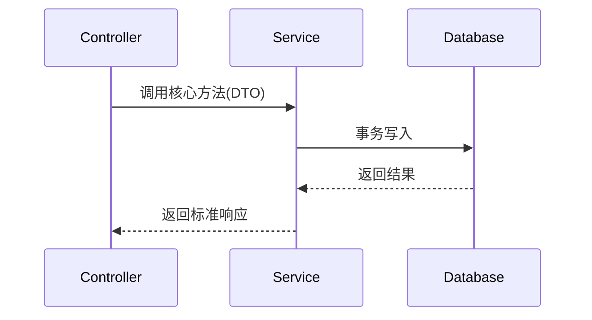

# 技术架构与接口设计 (Technical Design): {{FEATURE_NAME}}

- **关联需求**: `requirements.md`（G1 / G2 已通过）
- **设计者**: （模型 / 人）
- **状态**: Draft | Approved
- 追溯版本：1（新 Spec 启用需求映射校验；旧 Spec 无此行仍沿用旧门禁）

## 0. 模块关联（先确认改哪个模块、读哪份活文档）
> G3 校验：引用的模块活文档必须存在，且已在 `docs/architecture/00-INDEX.md` 登记；契约入口不得是占位符。
> 选错模块 / 跨模块直连内部实现 = 架构漂移，先停下回 00-INDEX 选对模块再设计。

- 主模块：<module> → `docs/architecture/modules/<module>.md`
- 涉及模块：无 / <module> → `docs/architecture/modules/<module>.md`
- 契约入口（只读）：`src/modules/<module>/index.ts`
- 新增模块：先在 `00-INDEX.md` 登记一行，再回来过 G3
> ①写「不适用」；②填写风险取舍、决策人和结论；③填写架构拆分、决策人和结论。此处是留痕，不是身份认证。
- 人工前置决策：
> ②③只有得到维护者明确授权，才在 G3 另加四行：条件委托决策人、条件委托来源、条件委托范围（填「仅 AC 全通过、G5 通过且无新增重大风险」）、条件委托结论（填「同意」）。G3 记录快照，事后新增或改写须重过 G3；没有授权就不要加。文本不是身份认证。

## 1. 架构变更与数据流 (Architecture & Data Flow)
> 说明影响哪些模块 / 表 / 契约；用 Mermaid 描述核心调用链；写清数据由谁拥有。严禁写冗长散文。



### 1.1 需求覆盖矩阵（②③必填）
> 逐一列出 requirements.md 的全部 REQ / ERR / AC 编号。来源锚点回指需求原文；设计落点写本文件章节或契约。检查遗漏，也检查无需求来源的新增接口、字段和行为。①可用单步精简设计。
| 来源 ID | 原文锚点 / 语义细则 | 设计落点 | 验证 |
| :-- | :-- | :-- | :-- |
| REQ-01 | requirements.md §2.3 / 原文关键短句 | §3.2 接口或 §2 步骤 | AC-01 |

## 2. 实现顺序、垂直切片与检查点
> 按依赖图**自底向上**推进（存储 → 协议 / 契约 → 业务逻辑 → 调用方 / 接口）。①类单文件小改动可只有一个可验证步骤；其余每 2~3 步设置检查点。
> 每一步都必须是能独立运行和验证的垂直切片，而不是"一次性写完再跑"。
> 设计出口：②③对照 requirements.md §2.3 核对数值、禁止项、互斥与时序；发现冲突先回需求澄清。拆分任务时引用本设计章节，不凭摘要改写约束。

1. 步骤 1：改哪个文件、做完后处于什么可运行状态、验证命令
2. 步骤 2：…
3. 步骤 3：…

- **检查点**（每 2~3 步插一个，写清检查什么、谁来看）：
  - 检查点 1（第 2 步后）：
- **拆分自查**（任一命中就先拆再写）：
  - 单步 >5 个文件？跨 2 个子系统？任务标题里出现「并且 / 同时」？
> ②③在首次完整 G4 前检查非默认配置、极值、兼容或失败路径；本行不能为空。
- 边界样本：

## 3. 接口契约与数据结构变更 (Contracts & Schema)

### 3.1 数据库 Schema 变更（如有）
- 新增 / 修改表字段及索引：

### 3.2 核心接口 / 类型定义（只列签名，不写实现）
```typescript
// 入参、出参、错误类型
```

### 3.3 契约兼容性
- 旧调用方 / 旧数据 / 旧客户端怎么办；是否需要 expand → migrate → contract 三步走。

## 4. 影响面与涉及文件清单 (Blast Radius & File Manifest)
> 编码阶段**只允许**动下面列出的文件；超出范围必须先停下更新本节并重新过 G3。
> 状态指纹从下列逐条反引号包围的**精确项目相对路径**读取；目录、通配符或缩写无法解析，会保守回退全仓。配置、测试及直接依赖也应列为「只读依赖契约」。
> scoped 指纹为显式选择：确认下列清单还覆盖 `CUSTOM_CHECK`、项目测试命令及其脚本、配置、测试依赖后，才加「指纹范围确认」行；无法确认就不加，继续全仓指纹。脚本无法自动推断任意 shell 命令的全部依赖。

- **新建文件**：
  - `path/to/new-file.ts`：职责说明

- **修改文件**：
  - `path/to/existing-file.ts`：修改点说明

- **只读依赖契约**：
  - `path/to/other-module/index.ts`

> 检查后台任务、数据管道、配置、权限、报告、Skill、文档、其他仓库或服务；确无则写「无」及依据。检索要记录路径、符号、调用方或有界搜索命令。
- 间接消费者 / 副作用：
- 检索依据：

## 5. 对抗自审（默认作者会过度自信）
> 逐条回答，答不出说明方案还不完整。这一节的结论会被 G3 检查是否填了实质内容。

1. 这个方案最可能错在哪？
2. 有没有未言明的假设（数据量、并发、权限、时序、外部依赖可用性）？
3. 哪些边界 / 失败路径没有处理？
4. 能不能更简单（少一个抽象层 / 依赖 / 配置 / 表）？
5. 上线后出问题怎么回滚？

- **自审结论**：

## 6. 待确认问题（产品 / 技术，清零或明确"不阻塞"后才能开工）
- [ ] Q1：

## 7. 风险与回滚
- **风险**：
- **回滚方式**：
